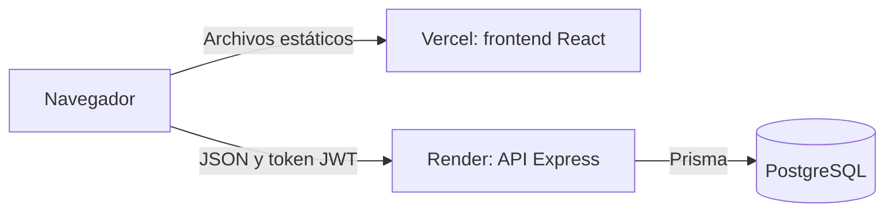
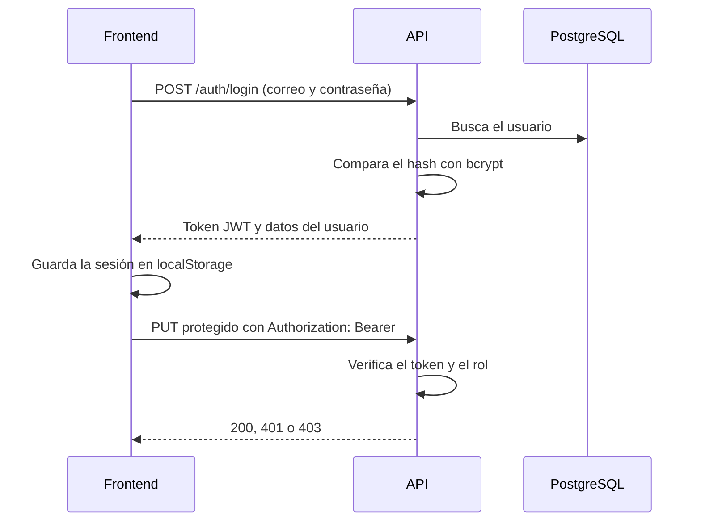
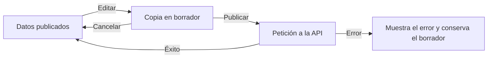

# Arquitectura

## Visión general

El sistema es una aplicación de página única (SPA) que consume una API REST con datos en PostgreSQL.



El frontend y el backend se despliegan por separado y no comparten código, por lo que los tipos están definidos en cada lado.

No todo el contenido está en la base de datos. Algunos catálogos y contenidos están en el código:

| Dato | Dónde vive | Cómo se cambia |
|---|---|---|
| Información general, parámetros, tarifa, costeo, noticias, reportes y usuarios | PostgreSQL | Desde la aplicación o la API |
| Lista de parámetros y límites | [parametrosCatalogo.ts](../backend/shared/parametrosCatalogo.ts) | Editar el código; el texto del límite solo cambia en los semestres nuevos, y el rango para sugerir estados se aplica de inmediato |
| Componentes iniciales del costeo | [costeoCatalogo.ts](../backend/shared/costeoCatalogo.ts) | Editar el código; solo se usa si la tabla está vacía |
| Capacitaciones | [capacitaciones.ts](../backend/modules/fortalecimiento/capacitaciones.ts) | Editar el código y desplegar |

## Backend

```text
backend/
├── server.ts          Arranque del servidor
├── app.ts             Configuración de Express y registro de rutas
├── middlewares/
│   ├── auth.ts        Autenticación y autorización
│   └── rateLimit.ts   Límite de peticiones
├── modules/           Un archivo de rutas por recurso
│   ├── auth/
│   ├── costeo/
│   ├── fortalecimiento/
│   ├── informacion-general/
│   ├── noticias/
│   ├── parametros/
│   ├── reportes-danos/
│   └── tarifa/
├── shared/            Cliente de Prisma, JWT, catálogos, validación y cálculo del semestre
└── prisma/            Esquema, migraciones y seed
```

Cada módulo define un `Router` de Express con la lógica directamente en sus manejadores, sin capas separadas de servicios o repositorios. Para añadir un recurso, crea su archivo de rutas en `modules/` y regístralo en [app.ts](../backend/app.ts).

[app.ts](../backend/app.ts) tiene un manejador de errores que responde siempre en JSON y solo registra en el log los errores 500. [rateLimit.ts](../backend/middlewares/rateLimit.ts) limita las peticiones de ingreso y de reportes por IP; los contadores están en memoria, así que se reinician con el servidor y requieren una sola instancia.

## Autenticación y autorización



El token contiene `sub` (id del usuario), `email`, `role` y `nombre`. Autorizar una petición no requiere consultar la base, así que un cambio de rol o la eliminación de una cuenta no surte efecto hasta que el token expira.

[auth.ts](../backend/middlewares/auth.ts) ofrece tres middlewares:

| Middleware | Uso | Sin token o con token inválido |
|---|---|---|
| `requireAuth` | Exige una sesión válida | Responde 401 |
| `requireRole(...roles)` | Se usa después de `requireAuth`; comprueba el rol | Responde 403 si el rol no está permitido |
| `attachUserIfPresent` | Rutas públicas cuya respuesta varía según el rol | Trata la petición como anónima |

Cada ruta declara sus roles de forma explícita, por ejemplo `requireRole('JUNTA', 'ENTIDAD_RECTORA')`. Así, cambiar los permisos de un endpoint solo requiere modificar esa lista.

> [!IMPORTANT]
> Las comprobaciones de rol del frontend solo deciden qué se muestra. La seguridad la garantiza el backend, así que todo endpoint nuevo debe declarar su protección.

## Frontend

```text
frontend/src/
├── main.tsx               Punto de entrada: BrowserRouter y JaapProvider
├── App.tsx                Definición de rutas
├── types.ts               Tipos compartidos del frontend
├── index.css              Tokens de diseño y clases de componentes
├── lib/
│   ├── api.ts             Cliente HTTP y un método por endpoint
│   ├── parametros.ts      Semestre actual y sugerencia de estado
│   └── video.ts           Convierte enlaces de YouTube y Vimeo a URL incrustables
├── state/
│   └── JaapContext.tsx    Estado global y lógica de negocio
├── components/            Header, Footer y Blueprint (marco visual)
└── pages/                 Una página por ruta
```

### Manejo del estado

Hay dos patrones según el tipo de dato:

- **Estado global en [JaapContext.tsx](../frontend/src/state/JaapContext.tsx):** sesión, información general, parámetros, tarifa y costeo. Se cargan una vez al abrir la aplicación y se acceden con el hook `useJaap()`.
- **Estado local en la página:** noticias, reportes de daños y capacitaciones. Cada página carga sus datos al montarse.

Información general, parámetros y costeo usan el mismo flujo de borrador. La tarifa no: sus campos modifican directamente el estado, y el botón «Publicar cargos» los envía a la API.



La sesión se guarda en `localStorage` con la clave `aguaGobernable.auth`. El contexto la cierra y muestra un aviso cuando llega la hora de expiración del token o cuando el servidor lo rechaza con un 401. El cliente de [api.ts](../frontend/src/lib/api.ts) convierte los roles del backend (`JUNTA`) al formato del frontend (`junta`) y lanza `ApiError` con el mensaje del servidor cuando una petición falla.

## Modelo de datos

El esquema completo está en [schema.prisma](../backend/prisma/schema.prisma). Los identificadores son UUID generados por Prisma.

| Modelo | Filas | Propósito |
|---|---|---|
| `User` | Una por cuenta | Credenciales y rol |
| `InformacionGeneral` | Una sola | Datos de la junta |
| `TarifaConfig` | Una sola | Cargos vigentes, sin historial |
| `ParametroMes` | Una por parámetro y semestre | Mediciones |
| `CosteoComponente` | Una por componente | Cantidad y precio anual |
| `Noticia` | Varias | Noticias publicadas |
| `ReporteDano` | Varias | Daños reportados |

Puntos a tener en cuenta:

- **Filas únicas.** `InformacionGeneral` y `TarifaConfig` no llevan restricción en la base: la aplicación siempre usa la primera fila que encuentra (`findFirst`).
- **Sin relaciones.** Los campos `creadoPorId` y `actualizadoPorId` guardan el id del usuario, pero no son claves foráneas.
- **Unicidad de parámetros.** La combinación `mes`, `categoria` y `nombre` es única.
- **Límites copiados.** Cada fila de `ParametroMes` guarda una copia del límite, por lo que cambiar el catálogo no altera los semestres ya creados.
- **Orden de semestres.** La API ordena `mes` como texto descendente, y `2026-II` queda antes que `2026-I`. El frontend toma la primera fila como semestre actual. `POST /parametros` solo admite el formato `AAAA-I` o `AAAA-II`.

## Migraciones

Las migraciones están en [backend/prisma/migrations](../backend/prisma/migrations). Dos de ellas son solo de datos y renombran el periodo registrado cuando la medición pasó de mensual a trimestral (`2026-09` a `2026-III`) y luego a semestral (`2026-III` a `2026-II`).
